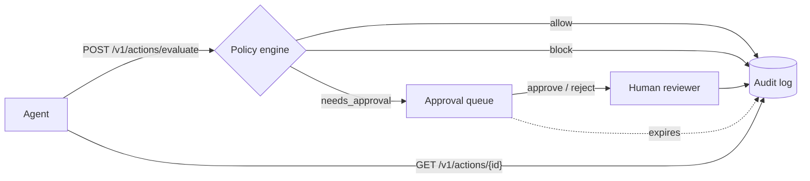

# Countersign

An approval and audit gateway that sits between AI agents and the actions they want to
take, so a human stays in the loop on anything risky and there's a tamper-evident record
of what happened.

## The problem

An agent wired up to tools like `issue_refund`, `send_email`, or `delete_record` can take
real, hard-to-undo actions on its own. Most agent frameworks have no place to enforce
"ask a human first" for the risky ones, and no durable, trustworthy record of what an
agent asked to do and why it was allowed, blocked, or sent for review — which is exactly
the kind of evidence Articles 12, 14, and 26 of the EU AI Act ask for. Countersign is
that place: agents send every tool call here *before* executing it, and get back one of
three decisions.

## How it works



One decision, three outcomes, one audit log. The agent calls `/v1/actions/evaluate`; a
YAML policy decides `allow`, `block`, or `needs_approval`. An `allow` or `block` is final.
A `needs_approval` action waits in a queue until a human approves or rejects it (or it
expires and is treated as blocked). Every step — the original decision, and any later
approve/reject/expiry — is written to the same append-only, hash-chained audit log, so
`GET /v1/audit?action_id=` shows an action's whole history in order.

## Quickstart

```bash
python -m venv .venv
.venv\Scripts\activate
pip install -e ".[dev]"
cp .env.example .env
uvicorn app.main:app --reload
```

Then, in another terminal, run the demo agent (it reads `DEMO_AGENT_API_KEY` from
`.env`, already filled in for local dev):

```bash
python demo/refund_agent.py --amount 20 --customer alice@example.com
python demo/refund_agent.py --amount 200 --customer bob@example.com --wait
```

The first call is small enough to auto-allow; the second needs a human, so with `--wait`
the agent polls until one decides. Approve or reject it yourself, as the reviewer:

```bash
curl -X POST http://localhost:8000/v1/approvals/<action_id>/approve \
  -H "Authorization: Bearer <REVIEWER_TOKEN from .env>" \
  -H "Content-Type: application/json" \
  -d '{"reviewer": "you", "reason": "looks fine"}'
```

Or with Docker Compose (Postgres 16 + the API):

```bash
docker compose up --build
```

## API

| Method | Path | Auth | What it does |
| --- | --- | --- | --- |
| `GET` | `/health` | none | Liveness check |
| `POST` | `/v1/actions/evaluate` | agent API key | Evaluate a tool call; writes an audit entry; enqueues an approval if `needs_approval` |
| `GET` | `/v1/actions/{action_id}` | agent API key (submitter only) | The action's current decision (reflects a later approve/reject/expiry) |
| `GET` | `/v1/audit?action_id=` | none yet — see Limitations | An action's full audit history |
| `GET` | `/v1/audit/verify` | none yet — see Limitations | Recomputes every hash; reports whether the chain is intact |
| `GET` | `/v1/approvals` | reviewer token | List queued approvals, optionally `?status=pending` |
| `GET` | `/v1/approvals/{action_id}` | reviewer token | Fetch one approval |
| `POST` | `/v1/approvals/{action_id}/approve` | reviewer token | `{"reviewer": "...", "reason": "..."}` |
| `POST` | `/v1/approvals/{action_id}/reject` | reviewer token | Same body shape |

Interactive docs (Swagger UI) are at `/docs` once the server is running.

## Policy

`policies/default.yaml` holds an ordered list of rules; the first whose tool-name glob
and argument conditions match wins, top to bottom:

```yaml
rules:
  - name: refund_small
    tool: "issue_refund"
    conditions:
      - field: amount
        op: lte
        value: 50
    decision: allow
    reason: "Refunds of $50 or less are auto-approved."

  - name: refund_medium
    tool: "issue_refund"
    conditions:
      - field: amount
        op: lte
        value: 500
    decision: needs_approval
    reason: "Refunds between $50 and $500 need human review."

default:
  decision: needs_approval
  reason: "No policy rule matched; default to human review."
```

An unmatched action falls through to `default`, which is `needs_approval` rather than
`allow` — fail closed. Override the file with the `POLICY_PATH` environment variable.
See [docs/decisions.md](docs/decisions.md) for the reasoning behind the rule format.

## The audit log

Every audit log entry's hash is the SHA-256 of all of its own fields, as canonical JSON,
plus the previous entry's hash — so each row is cryptographically chained to the one
before it. Editing a row changes its own hash; deleting a row breaks the next row's link
to it. `GET /v1/audit/verify` walks the whole log, recomputes every hash, and reports the
first row where something doesn't match. The first entry chains to a fixed 64-zero
genesis hash.

## Agents

Agents authenticate with `Authorization: Bearer <api key>`. Agents are registered in
[agents.yaml](agents.yaml) by the SHA-256 hash of their key — the raw key is never
stored. To register a new one: generate a key, hash it with `app.auth.hash_key`, and add
a line to `agents.yaml`. Override the file with `AGENTS_PATH`.

## Tests and linting

```bash
pytest --cov --cov-report=term-missing
ruff check .
```

63 tests, 93% line coverage as of this feature (`app/` and `demo/`); CI runs both on
every push and pull request, plus a job that builds the Docker image as a smoke test.
No coverage badge yet — see Limitations.

## Limitations and roadmap

Honest gaps as of this weekend, roughly in order of how much they'd matter before
anyone but me relies on this:

- **`GET /v1/audit` and `GET /v1/audit/verify` have no authentication.** Anything that
  can reach the API can read the full audit trail. Fine for local development; needs a
  real auth model before this is exposed anywhere else.
- **One shared `REVIEWER_TOKEN`, not per-reviewer logins.** The `reviewer` name on an
  approve/reject is self-reported in the request body, not tied to a real identity —
  anyone with the token can claim to be anyone.
- **No agent self-registration.** Adding an agent means hand-editing `agents.yaml` and
  restarting the server.
- **No rate limiting, pagination on list endpoints, or an audit log retention/export
  policy.**
- **No coverage badge.** Adding a real one (not a static/fake image) needs a hosted
  coverage service (e.g. Codecov) and its token, which isn't set up yet.
- **Policy is static rules only** — no risk scoring, no LLM in the loop yet.

Planned, roughly one feature per weekend:

| # | Feature |
| --- | --- |
| 2 | React + TypeScript approval inbox |
| 3 | Risk scoring: rules plus a Claude API score |
| 4 | MCP proxy mode — Countersign in front of any MCP server, no agent code changes |
| 5 | A 200-action labelled evaluation set: missed risks, wrongly blocked actions, latency |
| 6 | Slack and email notifications for pending approvals |
| 7 | Compliance evidence export mapped to EU AI Act Articles 12, 14, 26 |
| 8 | Public demo deploy, write-up; tag v0.5 |
| 9 | Python SDK on PyPI (`countersign.guard()` decorator) |
| 10 | Multi-tenant orgs, reviewer logins and roles |
| 11 | Load testing and p95 latency numbers |
| 12 | v1.0 release |

## Decisions log

Non-obvious choices are explained in [docs/decisions.md](docs/decisions.md).

## Licence

[MIT](LICENSE)
